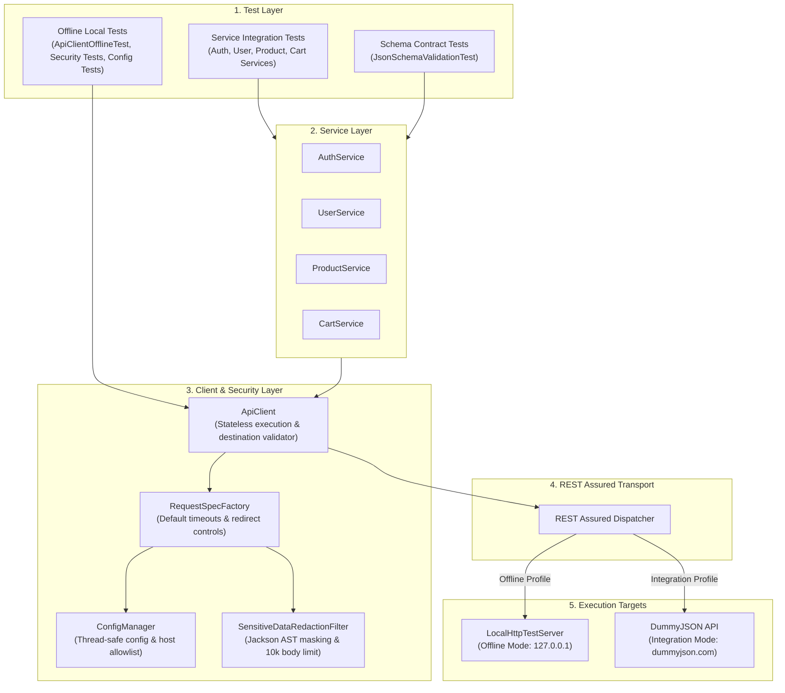

[](https://github.com/sksharma903231/java-api-automation-framework/actions/workflows/api-tests.yml)

# Java API Automation Framework

A modular REST API test automation framework built with Java 21, REST Assured, TestNG, Jackson, and Allure. The framework automates testing for authentication, users, products, and carts against the DummyJSON REST API, incorporating deterministic offline local mock testing, sensitive field redaction, and static analysis quality gates.

---

## 1. Key Features

- **Pre-Dispatch Destination Validation**: Validates the resolved target URL before network dispatch across all HTTP methods, preventing protocol-relative redirection and requests to unapproved hosts.
- **Sensitive Data Redaction & Bounded Logging**: Traverses JSON payloads via Jackson AST to mask sensitive values (`password`, `token`, `apiKey`, etc.) as `[REDACTED]`, strips query parameters from request logs, enforces a header allowlist, and bounds logged body output to 10,000 characters.
- **Dual Execution Modes**:
  - `offline`: Runs deterministic test suites locally against an in-process ephemeral HTTP server (`com.sun.net.httpserver.HttpServer`) with zero external network calls.
  - `integration`: Dispatches live requests against the target API host.
- **Strict Configuration Hierarchy**: Resolves configuration through Java system properties (`-D...`), environment variables, and `config.properties`, strictly validating schemes, ports, and allowed hosts.
- **Contract Schema Validation**: Validates API response bodies against Draft-07 JSON Schema specifications using REST Assured's JSON Schema Validator.
- **Thread-Safe Concurrency**: Employs stateless HTTP client dispatch and isolated `RequestSpecification` generation to support safe parallel test execution without cross-thread state leakage.
- **Data-Driven Testing**: Integrates TestNG `@DataProvider` with external JSON datasets for credential validation, boundary testing, and catalog queries.

---

## 2. Technology Stack

| Component | Library / Tool | Version | Purpose |
|---|---|---|---|
| Language | Java (JDK) | 21 (LTS) | Language runtime (Records, Text Blocks, Pattern Matching) |
| Build Tool | Apache Maven | 3.9+ | Dependency resolution and build lifecycle management |
| HTTP Client | REST Assured | 5.5.0 | Fluent REST API test harness |
| Test Runner | TestNG | 7.10.2 | Test execution, suite grouping, and parallelization |
| Object Mapping | Jackson Databind | 2.18.9 | JSON serialization, deserialization, and AST parsing |
| Assertions | AssertJ | 3.27.7 | Fluent assertion library |
| Schema Validation | JSON Schema Validator | 5.5.0 | Draft-07 JSON Schema compliance verification |
| Reporting | Allure TestNG | 2.35.6 | Test lifecycle logging and sanitized attachments |
| Logging | Log4j2 + SLF4J | 2.25.5 / 2.0.16 | Structured console and file logging |
| Code Conventions | Checkstyle Maven Plugin | 3.6.0 | Style and static code convention checks |
| Static Analysis | SpotBugs Maven Plugin | 4.8.6.6 | Bytecode analysis for security and concurrency bugs |
| Vulnerability Scanner | OWASP Dependency-Check | 12.2.2 | Software composition analysis and CVE scanning |
| Build Plugin | Maven Compiler Plugin | 3.13.0 | Compiles against Java 21 |
| Test Plugin | Maven Surefire Plugin | 3.5.2 | Executes TestNG suites |
| Reporting Plugin | Allure Maven Plugin | 2.15.2 (report 2.38.0) | Generates the Allure HTML report |
| CI Engine | GitHub Actions | Ubuntu Latest | Automated continuous integration pipeline |

---

## 3. Project Structure

```text
api-automation-framework/
├── .github/
│   └── workflows/
│       └── api-tests.yml                       # Hardened GitHub Actions pipeline
├── src/
│   ├── main/
│   │   ├── java/com/sksharma/api/
│   │   │   ├── clients/
│   │   │   │   ├── ApiClient.java              # Stateless HTTP client with pre-dispatch validation
│   │   │   │   ├── RequestSpecFactory.java     # RequestSpecification factory with timeout defaults
│   │   │   │   └── ResponseSpecFactory.java    # Shared response validation specifications
│   │   │   ├── config/
│   │   │   │   └── ConfigManager.java          # Thread-safe configuration manager and host allowlist
│   │   │   ├── constants/
│   │   │   │   ├── EndpointConstants.java      # Centralized API endpoint routes
│   │   │   │   └── HeaderConstants.java        # Standard HTTP headers
│   │   │   ├── filters/
│   │   │   │   └── SensitiveDataRedactionFilter.java # Jackson AST secret masking and header filter
│   │   │   ├── models/                         # DTOs (Java 21 Records and Jackson JavaBeans)
│   │   │   │   ├── auth/
│   │   │   │   ├── carts/
│   │   │   │   ├── products/
│   │   │   │   └── users/
│   │   │   └── services/                       # Domain service layer
│   │   │       ├── AuthService.java
│   │   │       ├── CartService.java
│   │   │       ├── ProductService.java
│   │   │       └── UserService.java
│   │   └── resources/
│   │       ├── config.properties               # Default framework configuration
│   │       └── log4j2.xml                      # Structured logging configuration
│   └── test/
│       ├── java/com/sksharma/api/tests/
│       │   ├── clients/
│       │   │   ├── ApiClientOfflineTest.java   # Local server suite (timeouts, verbs, concurrency)
│       │   │   └── ApiClientTest.java          # Client methods and secret leak verification
│       │   ├── config/
│       │   │   └── ConfigManagerTest.java      # Configuration loading and URL validation tests
│       │   ├── filters/
│       │   │   └── SensitiveDataRedactionFilterTest.java # Sanitization and limit unit tests
│       │   ├── listeners/
│       │   │   ├── TestExecutionListener.java  # TestNG lifecycle listener with sanitized reporting
│       │   │   └── TestExecutionListenerSecurityTest.java # Exception secret leak tests
│       │   ├── schemas/
│       │   │   └── JsonSchemaValidationTest.java # Contract schema compliance tests
│       │   ├── services/                       # Service-level integration tests
│       │   │   ├── AuthServiceTest.java
│       │   │   ├── CartServiceTest.java
│       │   │   ├── ProductServiceTest.java
│       │   │   └── UserServiceTest.java
│       │   ├── support/
│       │   │   └── LocalHttpTestServer.java    # In-process JDK HttpServer mock test harness
│       │   └── utils/
│       │       ├── TestCredentials.java        # Demo credential loader
│       │       └── TestDataLoader.java         # External JSON test dataset deserializer
│       └── resources/
│           ├── demo-credentials.properties     # Demo account test properties
│           ├── schemas/                        # Draft-07 JSON Schema files
│           ├── testdata/                       # External test dataset files
│           └── testng.xml                      # Master TestNG suite configuration
├── checkstyle.xml                              # Checkstyle ruleset
├── dependency-check-suppressions.xml           # Documented OWASP Dependency-Check suppressions
├── pom.xml                                     # Maven project descriptor
├── spotbugs-exclude.xml                        # SpotBugs exclusion filter for Jackson models
└── README.md                                   # Project documentation
```

---

## 4. Architecture Diagram



---

## 5. Prerequisites

- **Java Development Kit (JDK)**: Version 21 (LTS) installed and set in `JAVA_HOME`.
- **Apache Maven**: Version 3.9 or higher.
- **Git**: Installed for source control.

---

## 6. Configuration and Execution Modes

Configuration values are resolved using the following order of precedence:
1. **Java System Properties** (`-Dproperty=value`) — Highest precedence.
2. **Environment Variables** (`PROPERTY=value`).
3. **`config.properties` File** — Default fallback.

### Configuration Properties

| Property | Default | Description |
|---|---|---|
| `base.url` | `https://dummyjson.com` | Base target URL for HTTP requests. |
| `http.timeout.seconds` | `10` | Socket and connection timeout (accepted range: 1–300s). |
| `logging.include.body` | `false` | When `true`, logs redacted JSON request and response bodies. |
| `api.mode` / `test.profile` | `offline` | Execution mode: `offline` or `integration`. |
| `api.allowed.hosts` | `dummyjson.com` | Comma-separated list of permitted external hosts in integration mode. |

### Execution Mode Rules
- `offline`: Restricts target destinations strictly to loopback addresses (`localhost`, `127.0.0.1`, `::1`). External network calls trigger an `IllegalStateException` before socket creation.
- `integration`: Allows external destinations provided their host is explicitly allowlisted in `api.allowed.hosts`.

---

## 7. How to Run Offline Tests

Offline tests execute against `LocalHttpTestServer` with zero external network connectivity. This includes unit tests, client negative tests, concurrency tests, and configuration tests.

```bash
mvn clean verify -Poffline
```

The latest verified offline GitHub Actions run executed 115 tests with zero failures, errors, or skips. The command also validates code style via Checkstyle and performs bytecode analysis via SpotBugs.

---

## 8. How to Run Integration Tests

Integration tests run live service operations, schema verifications, and data-driven scenarios against DummyJSON. Active internet connectivity is required.

```bash
# Run integration tests against DummyJSON
mvn clean verify -Pintegration

# Run complete test suite (offline and integration suites)
mvn clean verify
```

To run with runtime configuration overrides:

```bash
mvn clean verify -Pintegration -Dbase.url=https://dummyjson.com -Dhttp.timeout.seconds=15
```

---

## 9. How to Run Checkstyle and SpotBugs

Static analysis quality gates can be executed independently without running the test suite:

```bash
# Audit code conventions against checkstyle.xml
mvn checkstyle:check

# Run SpotBugs static bytecode analysis
mvn compile spotbugs:check
```

Both plugins are configured with zero-tolerance rules (`failOnViolation=true` and `failOnError=true`).

---

## 10. How to Run OWASP Dependency-Check

Software composition analysis is configured via the `org.owasp:dependency-check-maven` plugin.

```bash
# Run dependency vulnerability scan against local cached database
mvn dependency-check:check -DautoUpdate=false

# Run via the security-scan Maven profile
mvn verify -Psecurity-scan -DskipTests -DautoUpdate=false

# Optional: Run with NVD API key to update vulnerability database
mvn dependency-check:check -DNVD_API_KEY=your_nvd_api_key
```

### Database Synchronization & Suppressions
- **Cached Database Usage**: Due to NIST NVD rate-limiting on unauthenticated clients (5 requests per 30 seconds), local unauthenticated execution relies on cached vulnerability data. Full synchronization requires an NVD API key.
- **Documented Suppressions**: Known non-applicable findings are documented in `dependency-check-suppressions.xml`. This includes `org.mozilla:rhino` (transitive test dependency via `json-schema-validator`), which is used solely for ECMA-262 regex matching without evaluating untrusted JavaScript.

---

## 11. CI Workflow Overview

Continuous integration is automated via GitHub Actions in [`.github/workflows/api-tests.yml`](.github/workflows/api-tests.yml):

- **Push and Pull Request Gate**: Executes `mvn clean verify -Poffline --batch-mode` across all pull requests and pushes to `main` and `master`, providing deterministic testing without third-party API dependencies. The latest verified [push run](https://github.com/sksharma903231/java-api-automation-framework/actions/runs/45458392627) completed successfully: 115 offline tests passed, and the separate dependency vulnerability scan also succeeded. This run verifies the offline profile, not the live integration profile.
- **Manual Execution (`workflow_dispatch`)**: Supports manual trigger with profile selection (`all`, `offline`, or `integration`).
- **Security Hardening**:
  - Third-party actions pinned to immutable commit SHAs (`actions/checkout@11bd719`, `actions/setup-java@3a4f6e1`, `actions/upload-artifact@4cec3d8`).
  - Scoped to least-privilege `permissions: contents: read`.
  - Enforces explicit job timeouts (15–20 minutes) and step timeouts (1–15 minutes).
  - Isolates repository secrets (`NVD_API_KEY`) to prevent exposure to pull requests from external forks.
- **Parallel Scanning**: Runs a dedicated `dependency-security-scan` job in parallel with test regression.
- **Artifact Retention**: Stores test logs, Surefire XML reports, Checkstyle XML, SpotBugs XML, Allure reports, and Dependency-Check reports for 14 days.

---

## 12. Reporting and Diagnostics

### Allure Test Report
Allure captures test metadata, execution status, steps, and sanitized HTTP attachments.

```bash
# Generate standalone HTML report
mvn allure:report

# Serve report locally in browser
mvn allure:serve
```

### Application Logs
Application logs are written to `logs/api-automation.log` and standard output. Sensitive fields and authorization headers are masked before being written to disk:

```text
2026-11-24 20:30:00.123 [main] INFO  c.s.a.f.SensitiveDataRedactionFilter - HTTP Outgoing Request:
POST /auth/login
--- Safe Headers ---
Content-Type: application/json
Request Body: {"username":"emilys","password":"[REDACTED]"}

2026-11-24 20:30:00.456 [main] INFO  c.s.a.f.SensitiveDataRedactionFilter - HTTP Incoming Response:
Status: HTTP/1.1 200 OK (333 ms)
--- Safe Headers ---
Content-Type: application/json; charset=utf-8
Response Body: {"id":1,"username":"emilys","accessToken":"[REDACTED]","refreshToken":"[REDACTED]"}
```

---

## 13. Known Limitations

1. **Target API Simulated Persistence**:
   - DummyJSON operates as an ephemeral mock REST API. `POST`, `PUT`, `PATCH`, and `DELETE` calls return success responses with generated identifiers, but changes are not persisted to a backend database across subsequent requests.
2. **Local Vulnerability Database Synchronization**:
   - Unauthenticated local executions of OWASP Dependency-Check use cached NVD data to avoid NIST rate limits. Real-time updates require setting the `NVD_API_KEY` environment variable.
3. **In-Memory Response Buffering**:
   - REST Assured operates as an in-memory client buffering response bodies into memory for JSONPath assertions. While logging limits prevent unbounded log expansion (capped at 10,000 characters), testing large multi-gigabyte files requires dedicated streaming HTTP clients.
